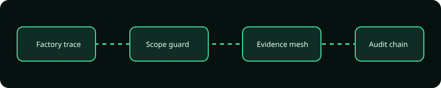

# Scopewright



**Adaptive governance for full-stack AI product factories.** Scopewright protects required product scope, spends verification effort where it matters, executes a seven-project capability mesh and preserves every decision in a restart-safe audit chain.

## What operators can do
- Evaluate a browser-to-persistence factory trace through a typed Rust service.
- Prove a denied scope reduction produced no forbidden downstream effect.
- Compare static, loop-aware and adaptive evidence strategies.
- Retrieve exact decisions and audit hashes after backend restart.

## Architecture
The React console calls the versioned v1 client. Ordered Axum middleware establishes correlation, authentication, authorization, validation, errors, timeouts and tracing. Twenty-five meaningful Rust crates compose domain governance, seven real upstream adapters and append-only external persistence. No service-owned database is used.


## Pinned capability mesh
Ruflo, MetaHarness, AgentDB, site-harness and sublinear-time-solver provide five distinct Ruvnet responsibilities. Microsoft TokenEconomizer and OpenTelemetry Collector Contrib provide enterprise loop control and correlated telemetry. Every dependency is pinned, licensed, called by production code and tested on intended and failure paths.

## Local run
```bash
cp .env.example .env
scripts/seed.sh
scripts/start.sh
```
Open `http://127.0.0.1:8787`. Stop with `scripts/stop.sh`; reset only generated local state with `scripts/reset.sh`.

## Verification
`scripts/verify-prototype.sh` is the canonical complete-product wrapper. `scripts/collect-product-evidence.sh <external-dir>` runs all ten suites and binds receipts to the clean commit. Publication is PR-only and human-merged; no deployment is performed.

Licensed under the [MIT License](LICENSE). Scopewright is a new standalone product; upstream projects retain their own licenses and attribution.
